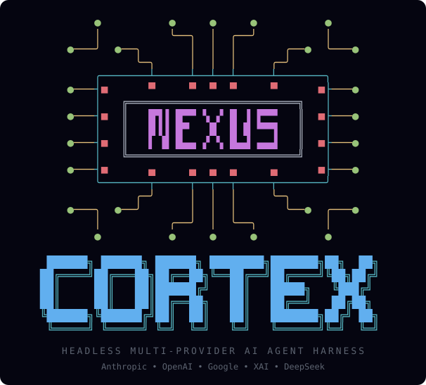

<p align="center">
  
</p>

# Nexus Cortex

> **A headless, multi-provider AI agent harness — embed it as a library, script it from the CLI, or run it as a stateful agent server.**

[](https://www.npmjs.com/package/@nexus-cortex/cli)
[](./LICENSE)
[](https://nodejs.org)

Nexus Cortex is the engine *underneath* the agent — not another interactive terminal app, but the harness you build on. One orchestrator drives many models across many providers through a pluggable adapter layer, with sub-agents, MCP, sandboxed artifacts, a permission engine, context management, and append-only session history built in.

Run it three ways: **as a library** (`import { CortexOrchestrator }`), **as a headless CLI** (`cortex "…"`), or **as a stateful HTTP agent server**.

> **Release 1 is the headless harness** — `core`, `executors`, `server`, `cli`. The interactive React/Ink terminal UIs (`@nexus-cortex/tui`) land in Release 2.

> **Driving it from your own agent harness?** Cortex is built to run as an autonomous **sub-agent** that another agent configures and prompts headlessly — often more precisely than a human at a UI can. The bundled **[`cortex-subagent`](.cortex/skills/cortex-subagent/SKILL.md)** skill is the operational formula: the three headless entry points, the config levers worth setting, how to write a self-contained autonomous brief, budgets, and orchestrator-side verification.

## Quick Start

```bash
npm install -g nexus-cortex
cortex setup
```

`cortex setup` is the first-run wizard: pick the providers you intend to use, paste their API keys, then choose the **action**
model (does the work), a cheap **helper** (compaction, summaries), the stronger **mentor** (plans and judges finishes), the vision
hand-off and the web-tools backend. It writes everything to `~/.cortex/.env`, then sends one tiny request to each chosen model so
you know it works before you start. One DeepSeek key is enough: the defaults run every role on `deepseek-flash`.

Running `cortex` before setup in a terminal starts the wizard for you. Prefer to script it? One provider key is all it takes:

```bash
cortex config set DEEPSEEK_API_KEY sk-...        # writes ~/.cortex/.env (or export it — the environment wins)
```

Then just talk to it — **the server auto-starts on first use**, and headless runs **auto-approve tools**:

```bash
cortex "What is this project?"                      # multi-turn; the session persists across calls
cortex agent --cwd ./my-project "add a --version flag and run the tests"   # one-shot autonomous run (alias: cortex run)
```

What you get out of the box: every role on `deepseek-flash` (served by DeepSeek-V4.1-Flash-1017), the `standard` lever profile
(the harness's proven failure-path and steering levers, interactive and headless; `CORTEX_PROFILE=off` restores the bare defaults),
and web page reads via WebFetch. Web **search** and **browse** turn on when a search-capable key is present (Gemini, Anthropic or xAI)
— `cortex setup` offers the choice. See how everything resolved with `cortex config get` or `GET /health/config` on the server.

> Claude also works with a Claude.ai Pro/Max OAuth subscription instead of an API key — see [docs/authentication.md](docs/authentication.md).
> Config precedence and every lever: [docs/configuration.md](docs/configuration.md).

## Everyday commands

| Task | Command |
|------|---------|
| First-run setup (providers, keys, model roles, web tools) | `cortex setup` |
| Set one key or lever | `cortex config set KEY value`  (or edit `~/.cortex/.env`) |
| Create the config file now | `cortex config init`  (keys-only; `--force` adds any missing provider-key slots) |
| Run a one-shot agent | `cortex agent "…"`  (auto-approves tools, fresh session, self-stops on idle) |
| Generate project context (`CORTEX.md`) | `cortex init` |
| Add an MCP server | `cortex mcp init` then `cortex mcp enable <name>`  (the browser already works zero-config) |
| Stop the background server | `cortex --shutdown` |
| Update to the latest version | `cortex update` |
| Uninstall | `cortex uninstall`  (or `npm uninstall -g nexus-cortex`) |

The server the CLI auto-starts persists in the background and **self-stops after 60s idle**. To run a long-lived, interactive server yourself, use `cortex-server` — it stays up until you stop it, and (being a real terminal) prompts for tool approval there.

## Customize it — your agents, skills, and commands

Cortex ships a library of agents, skills, and commands. Browse the bundled set in `~/.cortex/builtin/` (a read-only reference that re-syncs to your installed version automatically). To add your **own**, drop files into the matching folder in your home dir — they load alongside (and override) the builtins:

```
~/.cortex/agents/           your agent profiles (.md with YAML front-matter)
~/.cortex/skills/           your skills
~/.cortex/commands/         your slash commands
~/.cortex/system-messages/  your custom system prompts
~/.cortex/builtin/          read-only copy of everything that ships — look here for examples
```

These folders are created for you on first run, each with a short README. Agent profiles should use `model: inherit` (the default) — the agent then runs on whatever model the orchestrator is using, and falls back gracefully if a pinned model's provider key isn't configured.

## What the harness does between the model and the task

Most of Nexus Cortex is the layer that steers a cheap model through hard, long tasks — the part a bare API loop does not have:

- **Lift plan** — before the first edit, a mentor call (thinking on) turns the task into a plan with the real acceptance criteria and an
  edit scope; the action model follows it.
- **EndTurn judge + resolver** — a finish is not accepted on the model's say-so: a judge reads the evidence (checks run, outputs, the
  task's own rules) and returns MEETS or a GAP with a fix plan; the resolver carries the loop instead of the action model.
- **Exit planners** — a detected tool loop, a reasoning-exhaustion wall, or a looming deadline each route to a bounded planner call rather
  than letting the model spin.
- **Second attempt** — when a finish is accepted with a gap and budget remains, a fresh attempt is opened and the better one is selected.
- **Lever profiles** — every one of these is a lever with a ledger line. `CORTEX_PROFILE=standard` (shipped) turns on the proven safe set;
  `bench-tb4` reproduces our benchmark bundle; `off` is the bare frame. `cortex config get` shows every lever's resolved value and source.

Results and how to reproduce them: [docs/REPRODUCING_BENCH_RESULTS.md](docs/REPRODUCING_BENCH_RESULTS.md) and
[docs/RESULTS_2026-09_TERMINAL_BENCH.md](docs/RESULTS_2026-09_TERMINAL_BENCH.md). Every published number names the harness version,
the profile and the model weights date.

## Why Nexus Cortex

- **Every major provider, one harness.** The five major labs — **Anthropic, OpenAI, Google/Gemini, xAI, and DeepSeek** — are proven end-to-end. A dozen more (Cloudflare Workers AI, Zhipu/GLM, Qwen, Moonshot/Kimi, MiniMax, Mercury) are wired through the same adapter layer. <!--AUTO-COUNT:models-->121<!--/AUTO-COUNT--> models across <!--AUTO-COUNT:providers-->12<!--/AUTO-COUNT--> providers in all — switch mid-session, route from benchmark history, or mix providers across sub-agents. Run `cortex models list` for the live set.
- **Headless and scriptable by design.** No UI required. Pipe JSON, resume sessions by ID, and chain multi-turn agent workflows — the server is a *stateful agent*, not a stateless endpoint. Drop it in a container with secrets in the environment and it's a true one-shot: `npm i -g nexus-cortex` → `cortex "…"`.
- **An embeddable engine, not a closed app.** The orchestrator, adapters, <!--AUTO-COUNT:tools-->52<!--/AUTO-COUNT--> built-in tools, and middleware are a clean TypeScript library you build on.
- **A real harness, batteries included.** Parallel sub-agents (`Task`) with per-agent permissions, MCP tool integration (incl. a zero-config headless browser), a sandboxed-artifact toolset (run + inspect real web apps), git/PR tooling, a policy-based permission engine, token-budget + prompt-cache context management, and append-only JSONL sessions with file checkpoints.
- **Portable agent memory (canon).** Sessions live in a provider-neutral canonical JSONL store — the pattern the field now calls *portable agent memory* / *cross-harness handoff*. History is written once, lossless and append-only, and translated per provider at the edge: switch models mid-session, keep prompt caches warm, and carry context across harnesses. A git-backed backend (`GitHistoryStore`) makes that store a repo you own, and it keeps itself current: `cortex config set CANON_AUTO_SYNC true` syncs after every turn (debounced), `cortex canon watch` captures sessions any other harness writes on disk. See **[Canon](docs/CANON.md)**.
- **A built-in improvement loop (opt-in).** Build a baseline and a candidate, benchmark both on a graded task set, and gate a keep/discard decision with real statistics — driving the harness's own self-improvement (inspired by [karpathy/autoresearch](https://github.com/karpathy/autoresearch)).

## Documentation

| Doc | What's in it |
|-----|--------------|
| **[User Guide](docs/user-guide.md)** | The `cortex` CLI in full, running the HTTP server, the REST API, sessions, PR review, production deployment, troubleshooting |
| **[Architecture](docs/architecture.md)** | Monorepo layout, the orchestrator, providers, tools, sub-agents, auto-research, and the other core systems |
| **[Canon](docs/CANON.md)** | The canonical history & memory store — portable agent memory, the record format, the translation layer, cross-harness scope |
| **[Authentication](docs/authentication.md)** | Provider API keys and Claude OAuth setup |
| **[Configuration](docs/configuration.md)** | Every environment variable, annotated |
| **[Embed the library](docs/user-guide.md#install)** | Use `@nexus-cortex/core` directly in your own code |
| **[Drive as a subagent](.cortex/skills/cortex-subagent/SKILL.md)** | Run cortex headlessly as an autonomous sub-agent from your own agent harness — entry points, config levers, autonomous prompting, budgets, verification |
| **[Changelog](CHANGELOG.md)** | Release history |

## Contributing

Contributions welcome — see **[CONTRIBUTING.md](CONTRIBUTING.md)**.

## License

Apache-2.0 — see [LICENSE](LICENSE) and [NOTICE](NOTICE). Copyright 2026 Spitfire-Products.

Built clean-room as a multi-provider TypeScript agent harness.
